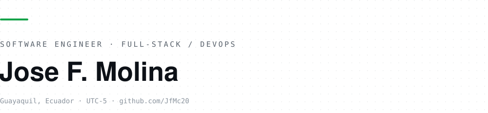

<picture>
  <source media="(prefers-color-scheme: dark)" srcset="./assets/banner-dark.svg">
  
</picture>

I build systems that survive measurement. Tests before code, deterministic-first
architecture, and verification against the real deployment instead of a green baseline.

`Python` `FastAPI` `Pydantic` `SQLAlchemy` `TypeScript` `React` `Vite` `Tailwind` `Radix UI` `Docker` `Linux` `pytest` `Playwright` `MCP`

## In the lab

**A WhatsApp bot engine sold as a service.** The business script is a YAML profile, not
code — onboarding a business is a config change, and the generic core holds no client data:

```
profile.yaml  ──►  generic engine  ──►  one isolated instance per business
```

**An Ecuadorian real-estate leads pipeline.** Ten public sources, one store, three
surfaces: a library, an HTTP API and an operator CLI.

**Headless CLI coding agents as a work force.** Frozen contracts, cross-model review and
output audits — delegated work gets verified, not trusted.

## Surfaces

| Surface | Why it exists |
| --- | --- |
| CLI | the operator's path; the same code path the API hits |
| HTTP API | FastAPI + Pydantic v2 contracts |
| MCP tools | an agent gets a scoped tool, never a shell |
| YAML profile | the client's business as data, not as a fork |

## Method

Red → green → refactor · real output, real diffs, real numbers · one service reaches
another only through its public surface · destructive commands are confirmed before they
run · config as data, not branches.

---

<sub>Telegram [@Jfmcs20_bot](https://t.me/Jfmcs20_bot) · Guayaquil, Ecuador (UTC-5) · most repositories are private: client systems and products under measurement.</sub>
